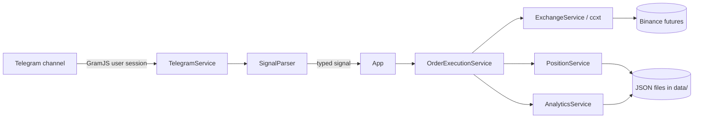

# resonance-trading-signals

[](https://github.com/nicolasMazuryk/resonance-trading-signals/actions/workflows/ci.yml)
[](LICENSE)

A Telegram-signal trading bot. It logs in to Telegram as a user (GramJS / MTProto), listens to a signal channel,
parses opening, closing, partial-close and update messages with regex parsers, and executes them on Binance USDT-M
futures through [ccxt](https://github.com/ccxt/ccxt).

## The problem

Signal channels publish free-text messages. Acting on them by hand is slow and error-prone: prices move, messages are
edited or replayed, and positions need their stop-loss and take-profit orders kept in sync. This bot turns each message
into a typed signal, rejects stale or duplicate ones, and manages the resulting position, with fee and slippage
analytics so you can see how far execution drifted from the published price.

## How it works



- **Parsing:** `Opening`, `Closing` / `Position Closed`, `Partial position close` and `Update` messages
  (see [docs/PRD.md](docs/PRD.md) for the formats).
- **Safety checks:** message-hash idempotency, a maximum signal age (`MAX_SIGNAL_AGE_MS`), an allow-list of source
  usernames and chat IDs, and an error blacklist for exchange errors that should not be retried.
- **Execution:** sets leverage, places a market entry sized from the signal's USDT position size, then stop-loss and
  take-profit orders; closing signals use `reduceOnly` market orders.
- **Storage:** signals, orders, positions and analytics are plain JSON files under `data/`.

## Stack

TypeScript, Node.js 20+, GramJS (`telegram`), ccxt, winston, commander, Vitest, ESLint + Prettier.
Deployment: Docker image to ECR, run on AWS ECS, defined with Terraform.

## Getting started

```bash
npm ci
cp .env.example .env        # then fill in the values
npm run session             # interactive: prints a TELEGRAM_SESSION string for .env
npm run dev                 # run with ts-node
```

Get `TELEGRAM_API_ID` and `TELEGRAM_API_HASH` from <https://my.telegram.org>. Use a Binance API key restricted to
futures trading with no withdrawal permission, and try it with tiny sizes first
(see [docs/exchange-setup.md](docs/exchange-setup.md)).

| Variable | Description | Default |
|---|---|---|
| `TELEGRAM_API_ID`, `TELEGRAM_API_HASH` | Telegram app credentials | required |
| `TELEGRAM_SESSION` | session string from `npm run session` | required |
| `TELEGRAM_ALLOWED_USERNAMES` | comma-separated source usernames | optional |
| `TELEGRAM_ALLOWED_CHAT_IDS` | comma-separated source chat IDs | optional |
| `EXCHANGE_ID` | ccxt exchange id | `binanceusdm` |
| `EXCHANGE_API_KEY`, `EXCHANGE_API_SECRET` | exchange credentials | required |
| `DEFAULT_LEVERAGE` | leverage applied before each entry | `10` |
| `ORDER_SLIPPAGE_TOLERANCE` | max price deviation for market orders | `0.2` |
| `MAX_SIGNAL_AGE_MS` | ignore signals older than this | `90000` |
| `TAKER_FEE`, `MAKER_FEE` | fee rates used by analytics | `0.0005`, `0.0002` |

Credentials are only ever read from the environment (`.env` locally, the ECS task definition in production).

## Scripts

| Command | What it does |
|---|---|
| `npm run build` / `npm start` | compile to `dist/` and run |
| `npm test` | Vitest unit tests (parser, fee calculator) |
| `npm run lint` / `npm run format` | ESLint / Prettier |
| `npm run cli` | inspect stored signals, orders and analytics |
| `npm run replay` | replay historical channel messages end to end ([docs/replay.md](docs/replay.md)) |

## Project layout

```
src/
  app.ts                 orchestration of signal -> position -> order
  parsers/               regex signal parsers (+ tests)
  services/              telegram, exchange (ccxt), order execution, positions, analytics, file storage
  config/                env loading, exchange error blacklist
  utils/                 logger, fee calculator
scripts/                 CLI, session generator, replay tools
docker/                  Dockerfile and ECR deploy script
terraform/               ECS, ECR, IAM, CloudWatch, SNS alerting
docs/                    PRD, exchange setup, analytics, infrastructure, replay
```

## Design decisions

- **Telegram user API instead of a bot token:** a bot cannot read another channel's messages; a user session can.
- **Files instead of a database:** one process, small volume, and the JSON files are easy to inspect and replay.
- **Idempotency by message hash:** reconnects and replays must never open a position twice.

## Roadmap and limitations

- No database: state lives in `data/*.json` on a single volume, so run exactly one instance.
- Regex parsers only understand the message formats listed in [docs/PRD.md](docs/PRD.md).
- Limit-entry strategies and alerting are tracked in [docs/todo.md](docs/todo.md).
- Trading carries real financial risk. This is a personal project, provided as-is and not financial advice.

## License

[MIT](LICENSE)
